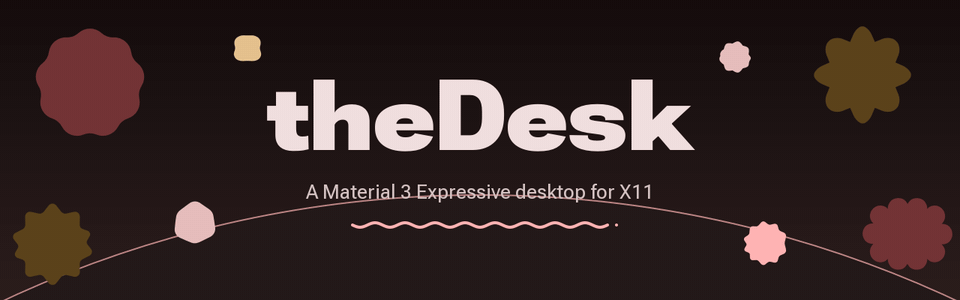
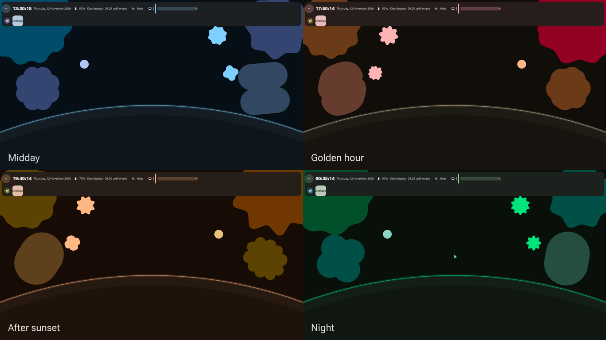
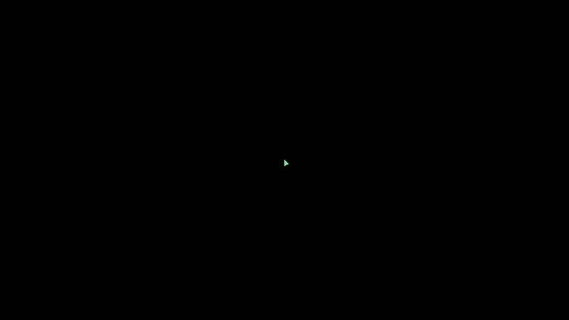
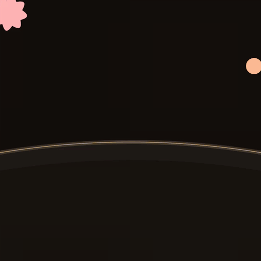
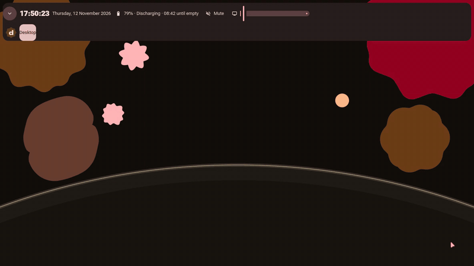
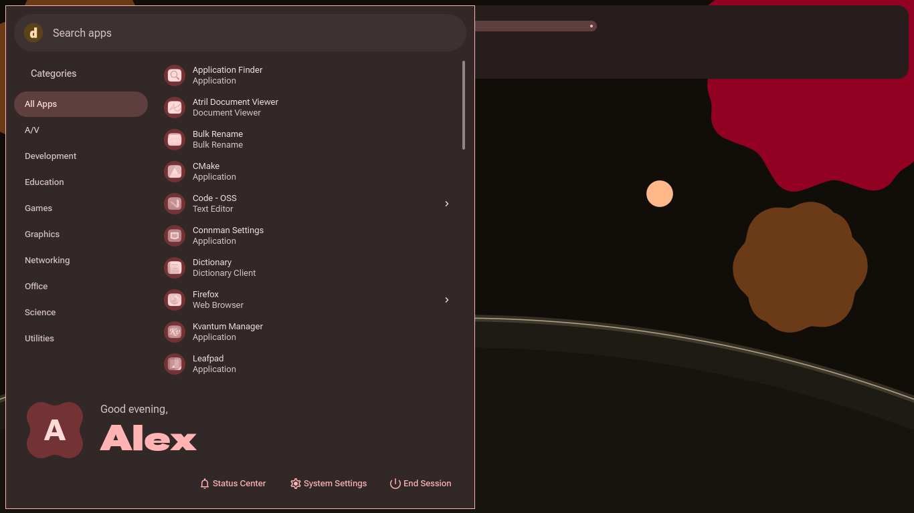
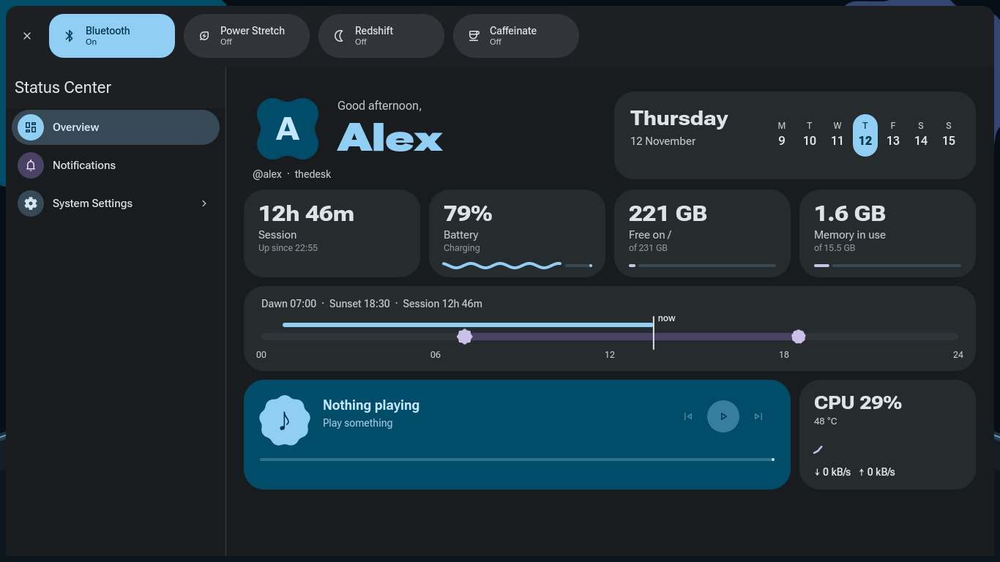
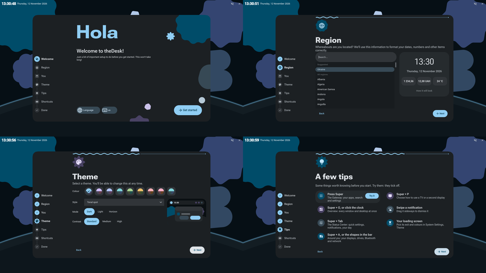

<p align="center">
  
</p>

<p align="center">
  
  
  
  
  
</p>

**theDesk** is a desktop environment built on Qt. This is a personal fork, redesigned
from top to bottom to look and move **as close as possible to Android's Material 3
Expressive**: shapes that morph, type that changes weight, springs instead of easing
curves, and colours that come from the sky outside.

It runs on **Artix Linux (OpenRC + elogind), X11 and bspwm**, and doubles as the
dotfiles for that machine (a ThinkPad T460).

> Upstream: [theCheeseboard/thedesk](https://github.com/theCheeseboard/thedesk), by Victor Tran and contributors.

---

## A desktop that follows the day

The wallpaper is a living planet horizon, and the whole desktop takes its colours from
it. The seed colour moves with the time of day, and every Material colour role (the
bar, sheets, buttons, the pointer, even the terminal's palette) is regenerated from it
as the day goes on.

<p align="center"></p>

## From power button to desktop, one animation

Limine, a Plymouth splash, a LightDM greeter, the loading screen and the desktop are
designed as one continuous piece. The loading screen is **living type**: kind words
drift past in Roboto Flex, swelling and thinning, until the desktop rises out of the
middle.

<p align="center"></p>

## Around you



**Super+A** opens *Around you*: your computer in the middle, the devices around it in
orbit. Each device keeps the same Material shape wherever it appears.

- **Drag a device onto the computer** to connect it. The computer glows and pulls it
  in, and a gooey link joins them.
- **Drag it away** and the link stretches, pinches off, and both halves pull back in
  as drops.
- **Displays** ask how to be used: extend, mirror, or only the TV.
- **USB drives** mount and eject. **Bluetooth** devices connect and disconnect.
- **Keyboard:** arrows, Enter and Delete.

<br clear="right" />

## The charging ripple

Plug the charger in and a wavy ring ripples across the screen from the corner where
it goes in, with sparkles riding inside it. The battery level fills a wavy progress
ring, then flies into the bar.

<p align="center"></p>

## Gateway and the Status Center

<p align="center">
  
  
</p>

**Super** opens the Gateway: your apps, search and the session. **Super+Tab** opens the
Status Center: quick settings, the day's light, battery, storage and what's playing,
drawn with wavy progress lines.

## Getting started

First login walks you through setup in Material steps. Each step has its own shape,
there's a live preview of how dates and numbers will look, and a mini desktop shows
your theme before you pick it. Tips can be tried right there.

<p align="center"></p>

## And more

- **iPhone notifications, with no app.** *Link an iPhone* in Bluetooth settings. It
  pairs like a watch (Apple Notification Center Service over Bluetooth LE), and calls
  can be answered from the desktop.
- **New displays.** A macOS-style chooser appears when you plug one in, and the choice
  is remembered per set of displays. **Super+P** brings it back.
- **Snackbars and sliders.** Snackbars take the place of pop-ups, and an M3E level
  slider shows volume and brightness at the edge of the screen.
- **Focus tide.** Press **Super+Z** and light crosses the bar while notifications wait.
- **Screenshots** go to the clipboard and `~/Pictures/Screenshots`.

---

## Material 3 Expressive, in Qt

Android's sources are the reference: Compose's tokens and `androidx.graphics.shapes`.
Widgets that Android doesn't have get designs that are consistent with Material.

| | |
|---|---|
| **Colour** | Google's [material-color-utilities](https://github.com/material-foundation/material-color-utilities) (HCT, tonal palettes, dynamic schemes), seeded from the horizon's time of day. The Light / Dark / Horizon mode and the Contrast level live in the Theme settings. |
| **Shape** | `androidx.graphics.shapes` ported to C++ (`m3/shapes/`): all 35 `MaterialShapes` plus `Morph`. Buttons morph on press, the user picture wears a cookie, and the loading indicator morphs from shape to shape. |
| **Motion** | Spring physics with Compose's tokens (`m3/m3motion.*`): spatial springs may overshoot, effects springs never do. `Platform/motion=standard` (in `theDesk.platform.conf`) swaps the expressive scheme for the calmer standard one. |
| **Type** | Roboto Flex everywhere, with its variable axes (weight, width, optical size) springing for emphasis. Google Sans Code in the terminal. |
| **Icons** | Material Symbols Rounded, drawn by a Qt platform icon engine from freedesktop icon names. |
| **Widgets** | A Qt style plugin, `Material3` (`style-m3/`): state layers, ripples, connected button groups, switches, sliders, wavy progress, M3 dialogs and bottom sheets. |
| **Pointer** | The theDesk-M3 cursor theme, generated in the current colours. |

---

## Setup

```sh
# 1. Packages (Artix repos)
sudo pacman -S --needed base-devel git cmake ninja clang qt6-tools qt6-svg qt6-multimedia \
  qt6-positioning qt6-declarative qt6-wayland qcoro polkit-qt6 networkmanager-qt \
  modemmanager-qt bluez-qt pulseaudio-qt qrencode libxss libxrandr libxext quazip-qt6 \
  libimobiledevice bspwm picom kitty starship zsh-autosuggestions zsh-syntax-highlighting \
  zsh-completions code zed tlp tlp-openrc xclip adw-gtk-theme noto-fonts ttf-roboto ttf-roboto-flex
# AUR: ttf-material-symbols-variable-git ttf-google-sans-code-vf

# 2. Build and install theDesk + its libraries (to /usr, via sudo)
scripts/build.sh

# 3. Dotfiles (+ system files, TLP, zsh login shell)
scripts/install-dots.sh --all

# 4. Network: ConnMan -> NetworkManager (theDesk's network UI needs it)
sudo scripts/switch-to-networkmanager.sh
```

Then pick **theDesk** in LightDM's session menu.

Optional, and machine-specific (read them first): `scripts/install-greeter.sh` (the
theDesk LightDM greeter), `scripts/install-plymouth.sh` (the boot splash) and
`scripts/install-limine.sh` (the themed Limine boot menu).

## Keys

| Key | Action |
|---|---|
| Super | Gateway (launcher) |
| Super+Tab | Status Center |
| Super+A | Around you |
| Super+P | Choose how to use displays |
| Super+O | Overview |
| Super+Z | Focus tide |
| Super+Escape | Lock |
| Super+Space | Next keyboard layout |
| Print Screen, Super+Alt+P | Screenshot |
| Alt+F2 | Run a command |
| Ctrl+Alt+Esc | Make a stuck app quit |
| Super+Return / Super+W / Super+E | kitty / Firefox / Zed |
| Super+C / Super+Shift+C | Close / force-stop window |
| Super+H J K L | Focus window (Shift: swap, Alt: resize) |
| Super+1…9, 0 / Super+Shift+1…9, 0 | Go to / send to desktop |
| Super+F / S / T / M | Fullscreen / floating / tiled / monocle |

Global shortcuts are theDesk's (`~/.config/theSuite/theDesk.conf`): built-ins under
`[Shortcuts]` (rebind by name; `none` turns one off), anything else under
`[CustomShortcuts]` (`Key=command`).

## Layout

| Path | What |
|---|---|
| `libthedesk/ desktop/ startdesk/ platform/ plugins/ locker/ polkitagent/ desktop-portal/` | theDesk itself |
| `m3/` | Material 3: colour schemes, motion springs, the shapes port, the cursor theme |
| `style-m3/` | The `Material3` Qt style |
| `greeter/ boot/` | The LightDM greeter, Limine and Plymouth themes |
| `deps/` | Vendored theDesk libraries, with local patches listed in `deps/README.md` |
| `dots/` | Dotfiles: `home/` (symlinked), `merge/` (merged into app-managed INI files), `seed/` (copied once, for settings apps rewrite), `system/` (copied to `/`) |
| `scripts/` | Build, dotfiles, boot chain and network setup |
| `docs/checkpoints/` | Screenshots from each stage of the redesign (`CHECKPOINTS.md`) |

## License

GNU General Public License, version 3 or later. See [LICENSE](LICENSE).
© Victor Tran and contributors; the Material 3 redesign is © its contributors.
The shapes port follows `androidx.graphics.shapes` (Apache 2.0).
